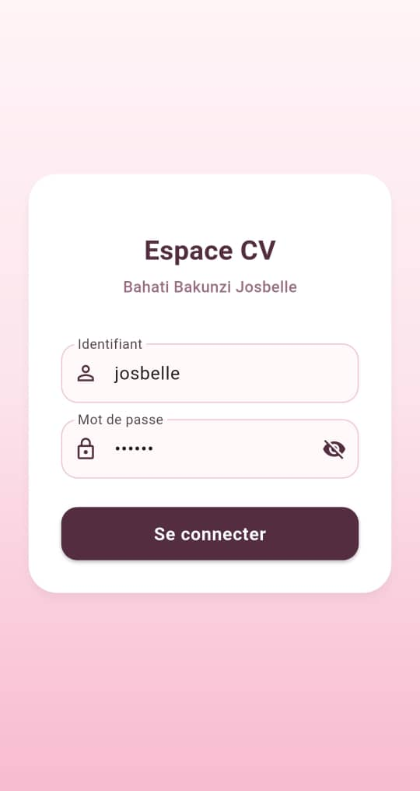
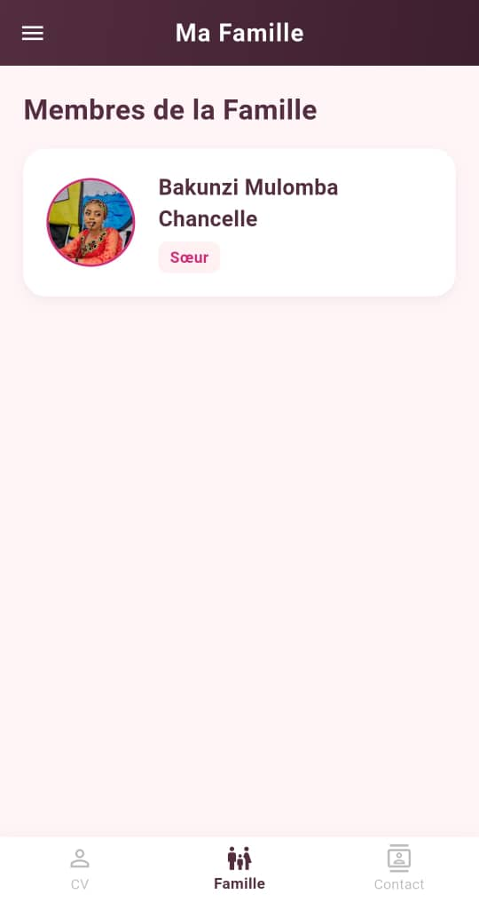

# CV Flutter — Bahati Bakunzi Josbelle

Application mobile Flutter qui présente le CV, la famille et les coordonnées de Bahati Bakunzi Josbelle.

## Fonctionnalités

- **Connexion** : formulaire avec identifiant et mot de passe.
- **CV** : profil, formation en informatique appliquée à la gestion des entreprises, expériences, compétences et centres d’intérêt.
- **Famille** : présentation des membres de la famille.
- **Contact** : téléphone, adresse e-mail, adresse et GitHub.
- **Navigation** : menu latéral et barre de navigation.

## Design

L’interface associe un fond rose très clair (`#FFF5F7`), des titres bordeaux (`#542D40`) et des accents rose poudré. Les cartes, les coins arrondis et les ombres discrètes donnent au contenu une présentation épurée.

## Captures d’écran

Les captures sont affichées à largeur fixe pour préserver leurs proportions et faciliter la lecture.

<table>
  <tr>
    <td align="center">
      <strong>Connexion</strong><br>
      
    </td>
    <td align="center">
      <strong>CV — partie 1</strong><br>
      
    </td>
  </tr>
  <tr>
    <td align="center">
      <strong>CV — partie 2</strong><br>
      
    </td>
    <td align="center">
      <strong>CV — partie 3</strong><br>
      
    </td>
  </tr>
  <tr>
    <td align="center">
      <strong>Famille</strong><br>
      
    </td>
    <td align="center">
      <strong>Contact</strong><br>
      
    </td>
  </tr>
</table>

## Installation et lancement

1. Cloner le dépôt :
   ```bash
   git clone https://github.com/josbkz/cv_flutter_josbelle.git
   ```
2. Installer les dépendances :
   ```bash
   flutter pub get
   ```
3. Lancer l’application :
   ```bash
   flutter run
   ```

---

Développé par **Bahati Bakunzi Josbelle**.
